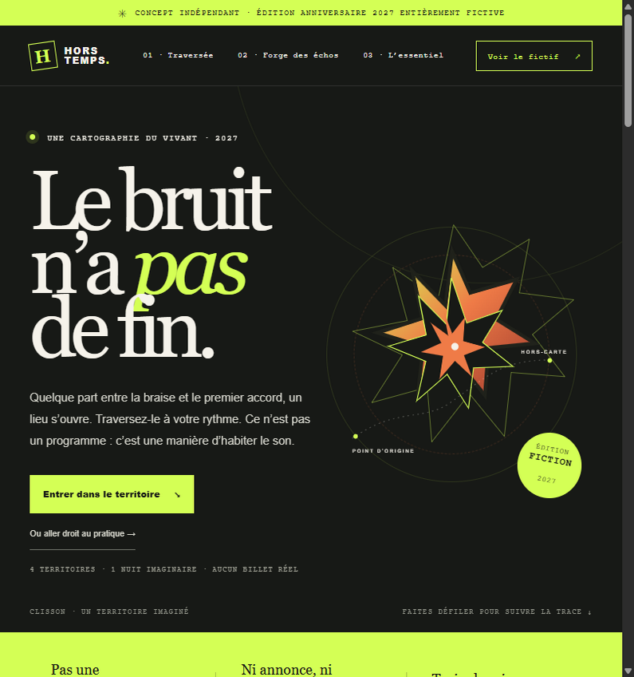
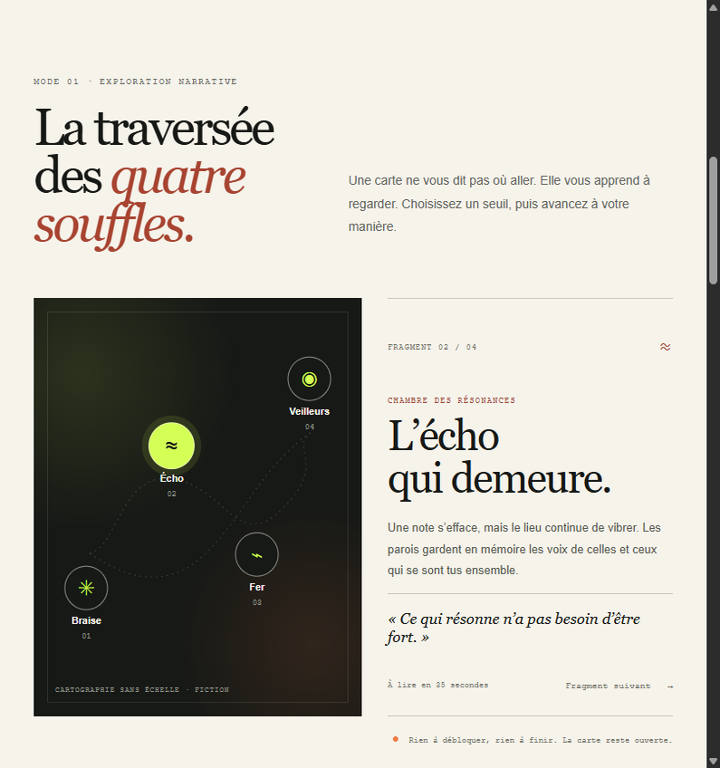
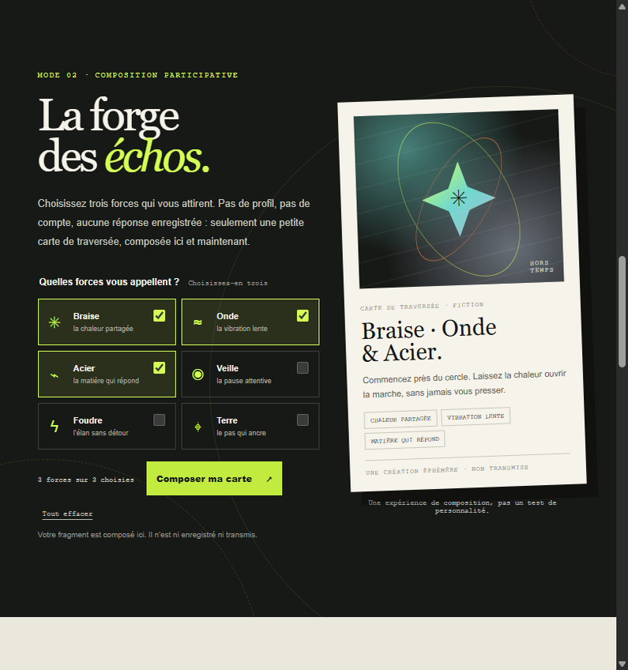
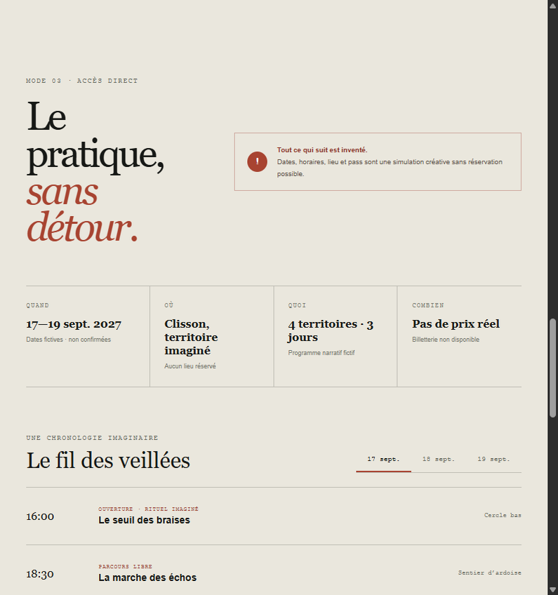

# Daybreak · HORS TEMPS

**[Découvrir la démonstration en ligne →](https://exywuu.github.io/HTS/)**

> **Prototype local fonctionnel — création indépendante, non officielle.** L’édition anniversaire 2027 imaginée ici est entièrement fictive ; elle n’est ni commandée ni approuvée par Hellfest et ne remplace pas son site officiel.

**HORS TEMPS — Le bruit n’a pas de fin** propose trois manières de parcourir une édition imaginaire : une traversée narrative, une composition participative et un accès direct aux renseignements fictifs. Le site ne vend rien et ne demande aucune donnée personnelle.

## Attribution de l’IA et origine de la demande

Ce projet a été réalisé par **Manus 2.0, agent d’intelligence artificielle**, en réponse à la demande reçue le 27 octobre 2026 et au brief créatif **LIVE EXPERIENCE 2027**.

La demande était un exercice créatif indépendant : **Hellfest n’a ni commandé, ni validé, ni annoncé cette édition**. L’anniversaire, le nom *HORS TEMPS*, le thème, les dates, le lieu imaginaire, le programme et les interactions événementielles sont des inventions pour ce prototype, sans prétention à correspondre à un anniversaire réel de l’organisation.



*Figure 1 — Capture authentique du prototype final dans le navigateur intégré Manus, le 27 octobre 2026, à 795 × 848 px. Ce n’est pas une maquette préparatoire.*

## Le brief et le statut

Le défi **LIVE EXPERIENCE 2027** demandait d’étudier cinq organisations, d’en choisir une, d’inventer une édition anniversaire fictive et de réaliser un site expérientiel réellement navigable. Il exigeait plusieurs parcours de découverte, un accès pratique direct, une expérience adaptée au smartphone, à la tablette et à l’ordinateur, des considérations d’accessibilité, ainsi qu’une séparation explicite entre réalité et fiction. Toute billetterie devait rester simulée, sans achat ni collecte de données.

Le prototype a été développé comme un site local statique. Les dates, horaires, lieux, pass, activités et éléments de programme présentés dans son univers sont inventés. Les renseignements officiels cités ci-dessous servent à documenter le choix de marque ; ils ne transforment pas le scénario fictif en annonce réelle.

## Comparaison concise des candidats

Les pages publiques ont été consultées le **27 octobre 2026**. Les faits ci-dessous résument les pages officielles accessibles ; leur présentation n’est pas une vérification indépendante de toutes les affirmations des organisations. Les pistes créatives et les besoins évoqués sont des **interprétations**, pas des résultats d’entretiens ou d’études de publics. L’analyse détaillée et ses limites se trouvent dans [ANALYSE.md](ANALYSE.md).

| Organisation | Faits vérifiés et sources consultées | Lecture créative et limites |
|---|---|---|
| **Shen Yun** | La compagnie se présente comme une compagnie new-yorkaise de danse et musique classiques chinoises fondée en 2006 ; son site décrit des spectacles en salle. [Présentation](https://www.shenyun.com/what-is-shen-yun), [FAQ](https://www.shenyun.com/faq), [billets](https://www.shenyun.com/tickets). | Un parcours pourrait explorer la relation entre danse, musique et décors. Il faudrait distinguer les tableaux scéniques des représentations du site sur l’histoire culturelle ; aucun examen exhaustif du contenu culturel n’a été effectué. |
| **Cirque du Soleil** | L’organisation situe ses origines au Québec en 1984 ; le site présente des spectacles en tournée et résidents, de l’information pratique et une visite virtuelle de son siège. [Histoire](https://www.cirquedusoleil.com/about-us/history), [spectacles](https://www.cirquedusoleil.com/shows), [FAQ](https://www.cirquedusoleil.com/faq/cirque), [siège](https://www.cirquedusoleil.com/about-us/headquarters). | Potentiel poétique fort, mais risque de confondre une invention avec une production réelle ou de reprendre des univers propriétaires. |
| **Country Jam** | Les pages accessibles décrivent un festival country à Grand Junction, Colorado, ainsi que des pass, du camping, l’accès et l’accessibilité. Plusieurs contenus consultés étaient datés de 2025 ; ils ne suffisaient pas à confirmer une programmation ultérieure. [Site](https://countryjam.com/), [pass](https://countryjam.com/festival-passes/), [camping](https://countryjam.com/camping/), [accès](https://countryjam.com/information/), [accessibilité](https://countryjam.com/accessibility/). | Le séjour et le camping suggèrent un parcours d’orientation et de préparation. L’actualité limitée des pages extraites restreignait la caractérisation de l’offre future. |
| **Hellfest** | Les pages officielles présentent ses débuts en 2006, des scènes et espaces scénographiés, une visite du site, des informations de billetterie 2027 et des engagements. Le site annonçait une édition réelle du 17 au 20 juin 2027, distincte de ce projet. [Expérience](https://hellfest.fr/experience), [visite](https://hellfest.fr/infos-pratiques/visite-du-site), [billetterie 2027](https://hellfest.fr/infos-pratiques/billetterie-hellfest-2027), [engagements](https://hellfest.fr/engagements). | Les lieux et la déambulation offrent un socle pertinent pour une cartographie fictionnelle. Les lieux, la musique et les contenus du prototype ne décrivent aucun service Hellfest réel. |
| **Lollapalooza Stockholm** | Le site officiel a fourni peu de contenu éditorial au-delà de l’écran de consentement. Une publication Instagram publique associée au festival annonçait en décembre 2023 une pause en 2024 afin de réévaluer l’expérience ; cela ne permet pas de conclure sur les éditions postérieures. [Site](https://www.lollastockholm.com/), [profil associé](https://www.instagram.com/lollapaloozase/?hl=en), [publication](https://www.instagram.com/lollapaloozase/p/C0wI7oBI8JR/). | La réflexion sur l’expérience pourrait nourrir une démarche participative, mais le contenu accessible était trop limité pour établir une lecture détaillée de l’offre ultérieure. |

## Choix et concept

Hellfest a été retenu non par classement de notoriété, mais parce que ses espaces et leur scénographie permettent d’imaginer un itinéraire numérique sensible, distinct d’une page de programmation. Le besoin auquel le prototype répond est une hypothèse de conception : laisser le visiteur choisir entre explorer librement et accéder immédiatement aux informations essentielles. Aucun test utilisateur n’a mesuré ce besoin.

L’édition **HORS TEMPS** imagine une traversée de quatre territoires — Braise, Écho, Fer et Veilleurs — rassemblés dans une célébration entièrement inventée. Elle ne prétend pas commémorer un anniversaire historique réel de Hellfest. La direction artistique associe charbon, papier chaud, vert acide et orange braise ; les signes, la carte, l’illustration vectorielle et la carte de fragments sont dessinés pour ce prototype, sans logo officiel, photographie, affiche ou slogan repris.

## Parcours réellement implémentés

1. **Traversée** — choisir l’un des quatre territoires pour afficher un fragment narratif, ou avancer de fragment en fragment. Aucun ordre ni « déblocage » n’est imposé.
2. **Forge des échos** — choisir trois forces parmi six afin de produire, dans le navigateur, un itinéraire textuel et une carte visuelle. L’état n’est ni enregistré ni transmis ; ce n’est pas un test de personnalité.
3. **L’essentiel** — lire les renseignements de la fiction, parcourir un horaire par jour, consulter les informations d’accès, d’accessibilité et la FAQ sans avoir à utiliser les deux autres modes.
4. **Démonstration de pass** — ouvrir puis fermer un dialogue clairement signalé comme fictif. Il n’y a ni prix réel, ni panier, ni formulaire, ni réservation.

### Autres vues finales

Les trois images ci-dessous sont, elles aussi, des captures authentiques du prototype final (27 octobre 2026, 795 × 848 px). Elles ont été capturées après la réalisation : **aucun croquis, moodboard, wireframe ou visuel de conception antérieur n’est disponible dans ce dépôt**.

<details>
<summary>Afficher les captures des interactions et de l’accès pratique</summary>

**Traversée — fragment « Écho » après sélection d’un nœud de la carte.** Capture finale après interaction, pas une maquette.



**Forge — carte composée après sélection de Braise, Onde et Acier.** Capture finale après interaction, pas une maquette.



**L’essentiel — aperçu pratique et programme d’une édition entièrement fictive.** Capture finale, pas une page d’information événementielle réelle.



</details>

Le compte rendu de la chronologie, y compris l’absence de maquette préparatoire, est dans [docs/PROCESS.md](docs/PROCESS.md). Le [plan de conception](PLAN.md) et l’[analyse de marque](ANALYSE.md) sont des documents récapitulatifs ; le plan a été mis par écrit après la construction du prototype et ne constitue pas une preuve de wireframe préalable.

## Lancer et tester

**Prérequis : Node.js 18 ou ultérieur.** Aucune dépendance ni installation n’est nécessaire.

```bash
npm start
```

Ouvrir ensuite <http://127.0.0.1:4173>. Le serveur écoute uniquement sur l’interface locale de l’ordinateur ; l’arrêter avec `Ctrl+C`. Pour lancer les tests automatisés :

```bash
npm test
```

## Technologies, ressources et structure

- HTML, CSS, JavaScript natif, SVG original et serveur HTTP Node intégré.
- Aucune bibliothèque, police distante, API ou base de données ; le site n’envoie pas de données.
- Les signes, la marque, l’illustration vectorielle et les motifs CSS ont été créés pour ce projet. Aucune photographie, vidéo, musique, affiche ou logo d’organisation n’est redistribué.
- Les références aux sites des organisations dans la documentation sont des liens de source, non des ressources intégrées à l’interface.

```text
.
├── index.html
├── styles.css
├── app.js
├── server.mjs
├── package.json
├── assets/mark.svg
├── tests/site.test.mjs
├── docs/PROCESS.md
└── docs/images/                 # captures authentiques du prototype final
```

## Vérifications et limites

- `npm test` : **4 tests réussis sur 4** (page et mention fictive, ressources statiques, refus d’accès hors du dossier du projet, 404).
- `node --check app.js` et `node --check server.mjs` : syntaxe vérifiée.
- Navigateur intégré Manus : rendu visualisé à 795 × 848 px ; un aperçu plus étroit d’environ 636 px a activé le menu compact par zoom du navigateur. Ce dernier n’était pas un smartphone physique.
- Interactions essayées : sélection d’un récit et passage au suivant, création d’une carte à trois choix puis remise à zéro, changement de jours par clic et flèche clavier, ouverture et fermeture du dialogue de pass. Aucune erreur console n’a été observée lors du contrôle final.
- Pas d’appareil physique, navigateur supplémentaire, audit WCAG automatisé, lecteur d’écran, score Lighthouse ou test de charge. Le site prend en charge `prefers-reduced-motion`, mais cette préférence n’a pas été auditée par un outil externe.

Les détails techniques, le contexte, la mesure de durée disponible et les limites sont consignés dans [TECHNIQUE.md](TECHNIQUE.md). Les tokens consommés et le coût interne de la plateforme ne sont pas disponibles.

## État GitHub

Le code et la documentation sont publiés sur [GitHub](https://github.com/Exywuu/HTS), et la [démonstration](https://exywuu.github.io/HTS/) est accessible en ligne.
